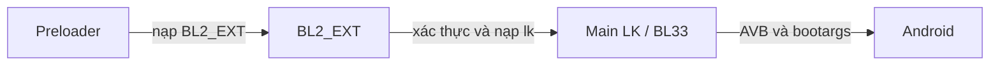

# 01 — Logic reverse và patch thành công

## Trả lời ngắn: vừa patch H4 vừa lấy thành phần H3

Không phải lấy toàn `lk.img` H3 đổi tên thành H4, cũng không phải chỉ sửa vài byte trong container H4 nguyên bộ. Bản đã boot kết hợp:

| Thành phần | Nguồn/cách xử lý |
|---|---|
| Main LK/BL33 | H4, patch 16 byte ở getter unlock |
| Main cert1 | H4 nguyên vẹn |
| Main cert2 | DER H4 nguyên vẹn, thêm hash prefix 180 byte |
| BL2_EXT + cert1 + cert2 | H3, nguyên vẹn cả header/payload/padding |
| AEE và certificates | H4 nguyên vẹn |
| Main DTB và certificates | H4 nguyên vẹn |
| DTBO và certificates | H4 nguyên vẹn |

Hai vấn đề được giải quyết riêng: **BL2 phải chấp nhận main LK đã sửa**, rồi **main LK phải báo và dùng trạng thái unlocked**.

## 1. Chuỗi boot được reverse



Preloader có hàm whole-file `0x6a7a4` chọn `bl2_ext`, qua loader `0x7eeec`. BL2 H4 có entry payload `0x9174` nạp member `lk` bằng loader `0x50eb8`. App descriptor đăng ký entry này dù broad Ghidra export ban đầu chưa nhận nó là function. Vì vậy danh sách hàm decompile không phải toàn bộ coverage.

Patch main LK chưa chạy ở lúc BL2 đang kiểm tra nó. Getter unlocked ở main không thể tự tắt xác thực tại tầng trước.

## 2. Getter H4 được patch gì?

Whole-file offset **`0x89cec`**, tương ứng main payload offset `0x89aec`, VA `0xffff000090789aec`:

```text
Original: 3f2303d5ff4305d1fd7b12a9fc5713a9
Patched:  68008052080000b900008052c0035fd6
```

```asm
mov w8, #3
str w8, [x0]
mov w0, #0
ret
```

Diễn giải hành vi, không phải source gốc:

```c
int mi_get_lock_state(uint32_t *state) {
    *state = 3;
    return 0;
}
```

Thay prologue bằng return sớm làm getter không chạy phần đọc/kiểm magic và unlock signature RPMB. Hàm tương ứng donor H3 ở whole-file `0x89a2c` cũng dùng đúng patch này.

Chuỗi wrapper H4: whole-file `0x88c10` → `0x89220` → `0x89cec`. Các caller đã kiểm tra coi state 3 là unlocked, state 4 là locked. Hệ quả qua main code: fastboot unlocked yes/secure no, callback AVB is_device_unlocked true, bootargs vbmeta.device_state unlocked và allowance cho một số lỗi AVB.

Điều đó không cho phép mọi lỗi format/I/O/thiếu partition, không ghi unlock vĩnh viễn vào RPMB, không chứng minh một critical-unlock độc lập. AEE có getter stub lỗi 4 riêng; bản đã boot không patch AEE.

## 3. Tại sao chỉ patch main H4 chưa đủ?

BL2 H4 truy policy tại payload `0x5b018` → `0x5b0f8`. Getter lock ở BL2 `0x52f04` là stub trả lỗi 4. Caller xử lý lỗi theo hướng yêu cầu xác thực. Probe actual ARM64 với các đầu vào SBC 0/1/2 và helper-error 5 đều trả auth_required 1 trong phạm vi đã thử.

Đường required-auth gồm certificate chain, anti-rollback, header auth, đọc payload rồi image auth. Không thể suy ENG preloader làm đường này tự bỏ xác thực.

## 4. Cơ chế certificate donor H3

Đặt `H` là header main 512 byte, `P` là payload theo declared size:

```text
header_hash  = SHA256(H)
payload_hash = SHA256(P + zero_padding_to_multiple_of_16)
```

OID `2.16.886.2454.2.4` mang header hash; OID `2.16.886.2454.2.1` mang payload hash. Prefix có hai block giống nhau, mỗi block 90 byte:

```text
A0 58
06 07 60 86 76 93 16 02 04
03 21 00
<header_hash: 32 byte>
06 07 60 86 76 93 16 02 01
03 21 00
<payload_hash: 32 byte>
```

Sau 180 byte prefix là DER H4 gốc giữ nguyên chữ ký. Main cert2 declared size đổi `0x3d6` → `0x48a`. Căn record 16 byte khiến phần tăng trước BL2 là 176 byte.

DER giữ signed hash main H4 gốc, khác hash payload sửa. Hash mới nằm ngoài DER được ký. Đây không phải ký lại ảnh bằng private key. Donor H3 cũng như vậy: khôi phục đúng 16 byte prologue khiến digest trùng lại signed donor hash, không cần giả thuyết patcher có private key.

Hai block được giữ vì đó là cấu trúc donor đã quan sát và tái tạo byte-for-byte. Chưa chứng minh mọi biến thể parser đều bắt buộc chính xác hai bản sao.

## 5. H4 thay đổi cơ chế nào?

| Parser BL2 | Phạm vi đọc hash |
|---|---|
| H3 payload `0x6cf8c` | Toàn bộ cert2, có thể thấy prefix ngoài DER |
| H4 payload `0x6d6bc` | Gọi helper `0x6cdc4` chọn TBS rồi chỉ đọc bên trong TBS |

TBS là phần certificate được ký. H4 còn bổ sung reset input cursor trước signature verification. Main LK H4 có sửa cursor tương tự. Đây là thay đổi logic thực sự, không chỉ do relocation/string rebuild.

Replay parser trên chính cert của artifact cuối cho thấy:

- H3 BL2 đọc hash payload đã patch: `848759443d2c436306e77df20bdcf87856fec4cb8806386c670db7a239385373`.
- H4 BL2 đọc hash payload H4 gốc đã ký: `db3e02a56f7e114b33631376128ef997c931f1111af0cf0f97f2aeb75f13a8e4`.

Cả hai parse status 0 chỉ nghĩa lấy field thành công. Bước so hash payload mới phân biệt ảnh sửa và ảnh gốc. Vì vậy đối chứng chỉ patch main H4 + prefix nhưng giữ BL2 H4 bị loại.

## 6. Tại sao ghép BL2 H3 giải quyết được?

Bộ BL2 H3 original có payload giống BL2 trong bản H3 patched từng hoạt động. Lấy nguyên ba record BL2/cert1/cert2 bảo toàn signed tuple của tầng trước. H3 BL2 dùng phạm vi parser chọn hash prefix phù hợp payload main H4 đã patch. Sau khi main được nạp, getter patch trả state 3 cho main/AVB.

Không sửa lệnh H4 BL2 rồi giả vờ signature còn khớp: sửa BL2 làm đổi digest do preloader kiểm. Các probe preloader trước đó lấy hash signed TBS trên đường được xét, nên thêm prefix vào BL2 sửa chưa tự giải quyết lớp này. Bản thực tế giữ signed H3 BL2 nguyên vẹn.

Giữ H4 AEE/DTB/DTBO tránh bê các thay đổi build/sạc từ donor H3. Donor H3 patched khác H3 original ở build string, nhiều địa chỉ chuỗi và DTBO; không dùng toàn diff làm patch.

## 7. Kết quả và phạm vi

328 ca CPU, parser actual hybrid và 10 DER signatures đã được kiểm tra. Người dùng sau đó xác nhận boot và fastboot unlocked yes; tiếp tục báo test thay stock preloader H4 được. Kết quả này xác nhận cấu hình thực tế được báo, không khẳng định mọi build/fuse/thiết bị.

Bản cuối: **4.083.424 byte**, SHA256 `f57d19c928b417ab082f06612038587fffadf693700e535eaa08542fa878c171`. Tất cả firmware giữ nguyên sau test. [Evidence chi tiết](06-evidence-and-limits.md).
